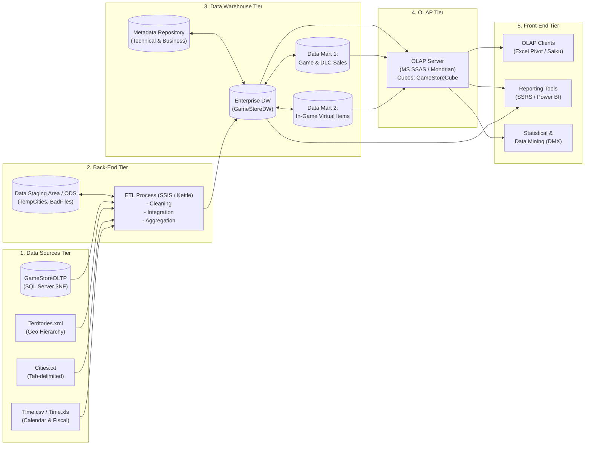
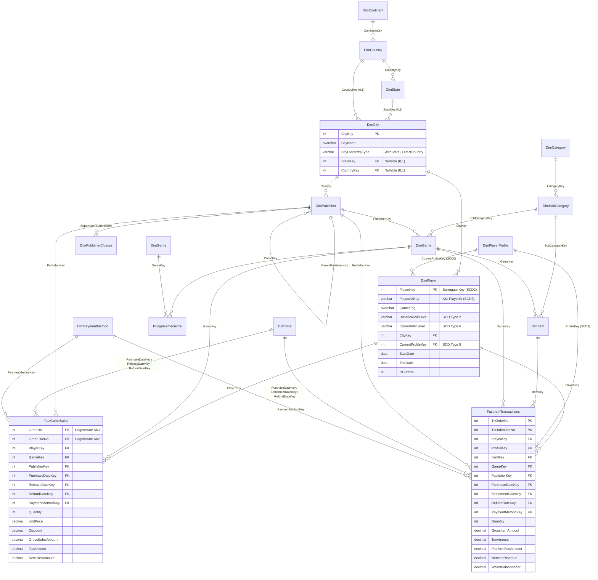
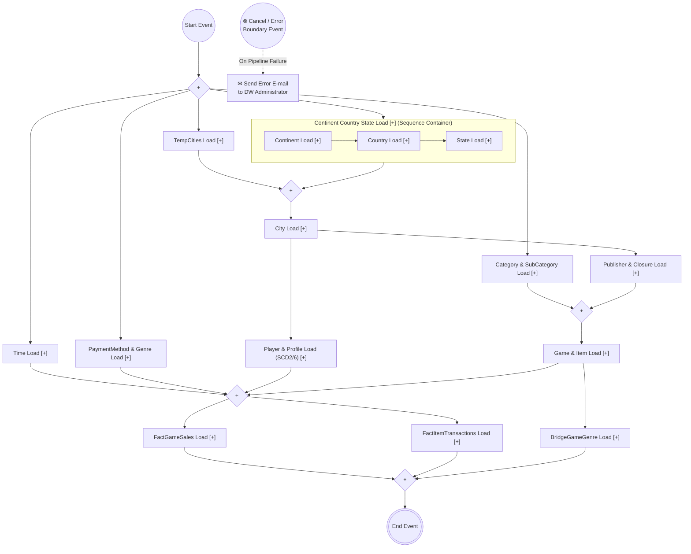
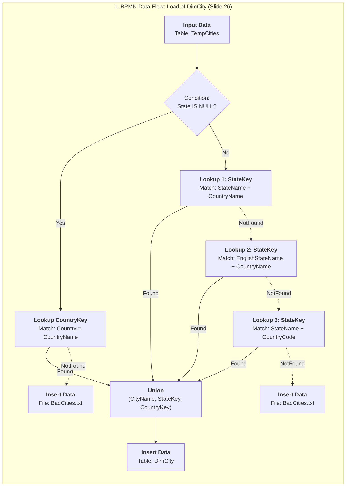

# ĐỒ ÁN MÔN HỌC KHO DỮ LIỆU (DATA WAREHOUSE)
**Đề tài:** Kho dữ liệu Phân tích Doanh thu Cửa hàng Game & Vật phẩm Ảo (*Digital Game Store & In-Game Items Data Warehouse*)  
**Phương pháp luận:** *Data Warehouse Systems: Design and Implementation* (Alejandro Vaisman & Esteban Zimányi) — Chuẩn giáo trình Khoa Khoa học Máy tính, VKU (Chapters 1 – 6).

> [!TIP]
> **Toàn bộ mã nguồn thực thi (Runnable SQL, XML, Mock Data)** đã được khởi tạo đầy đủ trong thư mục dự án tại workspace của bạn:
> - [01_Create_GameStoreOLTP.sql](file:///d:/VScode/GameStoreDW_Project/01_Create_GameStoreOLTP.sql) — Tạo CSDL nguồn 3NF `GameStoreOLTP`
> - [02_Create_GameStoreDW.sql](file:///d:/VScode/GameStoreDW_Project/02_Create_GameStoreDW.sql) — Tạo Kho dữ liệu `GameStoreDW` (Constellation Schema, SCD 2/4/5/6/7, Ragged XOR Check Constraints, Closure Table)
> - [03_MockData_ETL_Load.sql](file:///d:/VScode/GameStoreDW_Project/03_MockData_ETL_Load.sql) — Sinh 10.000+ dòng giao dịch giả lập & chạy toàn bộ luồng ETL nạp vào `GameStoreDW`
> - [04_SQL_OLAP_and_MDX_Queries.sql](file:///d:/VScode/GameStoreDW_Project/04_SQL_OLAP_and_MDX_Queries.sql) — Bộ 14 câu truy vấn MDX & 14 câu truy vấn SQL/OLAP đối sánh
> - [05_Physical_Design_Tuning.sql](file:///d:/VScode/GameStoreDW_Project/05_Physical_Design_Tuning.sql) — Indexed Views, Partitioning theo năm, Partition-Aligned Indexed View & Columnstore Index
> - [06_Mondrian_GameStoreDW_Schema.xml](file:///d:/VScode/GameStoreDW_Project/06_Mondrian_GameStoreDW_Schema.xml) — Schema XML đầy đủ cho Pentaho Mondrian OLAP Server
> - Các file nguồn ngoại vi phục vụ SSIS/Kettle: [Territories.xml](file:///d:/VScode/GameStoreDW_Project/data/Territories.xml), [Cities.txt](file:///d:/VScode/GameStoreDW_Project/data/Cities.txt), [Time.csv](file:///d:/VScode/GameStoreDW_Project/data/Time.csv)

---

## GIAI ĐOẠN 1: KIẾN TRÚC TỔNG THỂ, ĐẶC TẢ YÊU CẦU & MÔ HÌNH Ý NIỆM (CHAPTER 1 & CHAPTER 2)

### 1.1. Kiến trúc Kho dữ liệu 5 tầng (5-Tier Data Warehouse Architecture — Ch.1 Slide 7–13)

Hệ thống Kho dữ liệu `GameStoreDW` được thiết kế theo kiến trúc 5 tầng chuẩn công nghiệp kết hợp phương pháp **Top-down** và **Model-based**:



---

### 1.2. Phân tích yêu cầu theo phương pháp kết hợp (Analysis/Source-Driven Approach — Ch.1 Slide 40–58)

#### A. Hướng tiếp cận Analysis-Driven (Từ nhu cầu phân tích của người dùng — Ch.1 Slide 41–50)
1. **Xác định 3 nhóm người dùng (Identify Users):**
   - **Executive Users (Ban Giám đốc điều hành nền tảng Game Store):** Cần bức tranh toàn cảnh về tổng doanh thu ròng (`NetSalesAmount`), tốc độ tăng trưởng năm/quý (YoY, QoQ) giữa mảng bán Game bản quyền và mảng kinh tế Vật phẩm ảo (Passes, Keys, Skins) trên toàn cầu.
   - **Management Users (Giám đốc Kinh doanh Khu vực & Giám đốc Sản phẩm):** Cần phân tích chi tiết hiệu quả theo từng thị trường (`Continent -> Country -> State -> City`), theo dõi cơ cấu doanh thu của từng tập đoàn phát hành mẹ – studio con (`Publisher`), và đánh giá hiệu quả khuyến mãi (`Discount`).
   - **Professional Users (Chuyên viên Vận hành Live-Ops & Marketing):** Cần theo dõi hành vi mua sắm theo cấp độ thành viên (`VIPLevel`), tỷ lệ hoàn tiền (`Refund`), phân bổ doanh thu theo thể loại game (`Genre`), và danh sách các vật phẩm `Immortal`/`Arcana` bán chạy nhất.

2. **Xác định nhu cầu phân tích (Determine Analysis Needs — Goals & Subgoals):**
   - **Mục tiêu tổng quát (General Goal):** Tăng tổng doanh thu ròng toàn hệ sinh thái (`GameStore + In-Game Items`) thêm **15%/năm**.
   - **Phân rã thành 4 mục tiêu con (Subgoals) & các truy vấn nghiệp vụ cụ thể (Operationalized Queries):**
     - **Subgoal 1 — Tối ưu hóa doanh thu tại các khu vực địa lý:**
       - *(1a)* Top 5 cặp Quốc gia người chơi (`Player Country`) và Quốc gia nhà phát hành (`Publisher Country`) có doanh thu cao nhất/thấp nhất.
       - *(1b)* Các Quốc gia, Bang (`State`) và Thành phố (`City`) có tổng doanh thu ròng cao nhất cùng tỷ trọng đóng góp so với Châu lục.
       - *(1c)* Top 3 quốc gia tiêu thụ Vật phẩm ảo nhiều nhất so sánh với nhóm các quốc gia còn lại (*Other Countries*).
     - **Subgoal 2 — Gia tăng giá trị vòng đời người chơi (Player LTV & VIP Upgrades):**
       - *(2a)* Doanh thu hàng tháng theo từng người chơi và hạng `VIPLevel` so với cùng kỳ năm trước.
       - *(2b)* Tổng số đơn hàng (`OrderNo`), số lượng dòng sản phẩm trung bình và giá trị trung bình mỗi đơn hàng theo từng tháng.
       - *(2c)* Đơn giá mua trung bình (`UnitPrice`) và số dư ví (`WalletBalance`) theo từng phân khúc khách hàng.
     - **Subgoal 3 — Thúc đẩy doanh số danh mục Game, DLC & Vật phẩm ảo:**
       - *(3a)* Doanh thu lũy kế đầu năm (`YTD`) và trung bình trượt 3 tháng (`3-Month Moving Average`) của từng danh mục (`Category`).
       - *(3b)* Mức chiết khấu trung bình (`Discount %`) và tổng tiền giảm giá theo từng sản phẩm và tháng.
       - *(3c)* Phân bổ doanh thu công bằng theo từng Thể loại (`Genre`) có tính trọng số (`WeightFactor`) để chống trùng lặp (*double-counting*).
     - **Subgoal 4 — Đánh giá hiệu suất của các Tập đoàn Phát hành (Parent-Child Publishers):**
       - *(4a)* Nhà phát hành bán chạy nhất theo từng danh mục sản phẩm và từng năm.
       - *(4b)* Doanh thu trung bình hàng tháng của từng Studio phát hành theo từng năm.
       - *(4c)* So sánh doanh thu trực tiếp (`Personal Sales / DataMember`) của công ty mẹ với tổng doanh thu gộp cả các studio con trực thuộc.

3. **Ma trận ánh xạ yêu cầu (Analysis-Driven Requirement Mapping Matrix — Ch.1 Slide 50):**

| Dimensions / Measures | Hierarchies and Levels | 1a | 1b | 1c | 2a | 2b | 2c | 3a | 3b | 3c | 4a | 4b | 4c |
| :--- | :--- | :-: | :-: | :-: | :-: | :-: | :-: | :-: | :-: | :-: | :-: | :-: | :-: |
| **Publisher** | **StudioHierarchy** (`SubStudio -> ParentStudio` đệ quy)<br/>**Geography** (`Publisher -> City -> State -> Country -> Continent`) | $\checkmark$ | - | - | - | - | - | - | - | - | $\checkmark$ | $\checkmark$ | $\checkmark$ |
| **Time** | **Calendar** (`Date -> Month -> Quarter -> Semester -> Year`)<br/>**Fiscal** (`Date -> Month -> FiscalQuarter -> FiscalSemester -> FiscalYear`) | - | - | - | $\checkmark$ | $\checkmark$ | - | $\checkmark$ | $\checkmark$ | - | $\checkmark$ | $\checkmark$ | $\checkmark$ |
| **Game / Item** | **Categories** (`Game/Item -> SubCategory -> Category -> Department`)<br/>**EngineHierarchy** (`Game -> Engine -> EngineVendor`) | - | - | $\checkmark$ | - | $\checkmark$ | - | $\checkmark$ | $\checkmark$ | $\checkmark$ | $\checkmark$ | - | - |
| **Genre** | **GenreHierarchy** (`Game ⇇ Genre -> SuperGenre` Nonstrict/M2M) | - | - | - | - | - | - | - | - | $\checkmark$ | - | - | - |
| **Player** | **Geography** (`Player -> City -> State (0,1) -> Country -> Continent`) | $\checkmark$ | $\checkmark$ | $\checkmark$ | $\checkmark$ | $\checkmark$ | $\checkmark$ | - | - | - | - | - | - |
| **Order** | **Degenerate** (`OrderLineNo -> OrderNo`) | - | - | - | - | $\checkmark$ | - | - | - | - | - | - | - |
| *Quantity* | Measure (Additive, Distributive - `SUM`) | - | - | $\checkmark$ | - | $\checkmark$ | - | - | - | - | - | - | - |
| *UnitPrice* | Measure (Non-additive `⧺`, Algebraic - `AVG`) | - | - | - | - | - | $\checkmark$ | - | - | - | - | - | - |
| *Discount* | Measure (Non-additive `⧺`, Algebraic - `AVG`) | - | - | - | - | - | - | - | $\checkmark$ | - | - | - | - |
| *TaxAmount* | Measure (Additive, Distributive - `SUM`) | - | $\checkmark$ | - | - | - | - | - | - | - | - | - | - |
| *GrossSalesAmount* | Measure (Additive, Distributive - `SUM`) | $\checkmark$ | $\checkmark$ | $\checkmark$ | $\checkmark$ | $\checkmark$ | - | $\checkmark$ | $\checkmark$ | $\checkmark$ | $\checkmark$ | $\checkmark$ | $\checkmark$ |
| */NetSalesAmount* | Derived Measure (`GrossSalesAmount - TaxAmount`) | $\checkmark$ | $\checkmark$ | $\checkmark$ | $\checkmark$ | $\checkmark$ | - | $\checkmark$ | - | $\checkmark$ | $\checkmark$ | $\checkmark$ | $\checkmark$ |
| *WalletBalanceAfter* | Measure (Semi-additive `+!` across Time - `AVG/LASTNONEMPTY`) | - | - | - | - | - | $\checkmark$ | - | - | - | - | - | - |

#### B. Hướng tiếp cận Source-Driven (Suy diễn từ CSDL tác nghiệp `GameStoreOLTP` — Ch.1 Slide 51–57)

Bảng kết quả áp dụng quy trình suy diễn (**Derivation Process** — tương ứng Slide 56 Chương 1):

| Facts | Measures | Dimensions & Cardinalities | Hierarchies and Levels |
| :--- | :--- | :--- | :--- |
| **GameSales** &<br/>**ItemTransactions** | `Quantity`<br/>`UnitPrice`<br/>`Discount`<br/>`TaxAmount`<br/>`PlatformFeeAmount`<br/>`GrossSalesAmount`<br/>`/NetSalesAmount`<br/>`WalletBalanceAfter` | `Game` (`1:n`)<br/>`Item` (`1:n`) | **Categories**: `Game/Item -> SubCategory -> Category -> Department`<br/>**EngineHierarchy**: `Game -> EngineName -> EngineVendor` |
| | | `Genre` (`n:m`) | **GenreHierarchy**: `Game ⇇ Genre -> SuperGenre` (Distributing `WeightFactor ÷`) |
| | | `Publisher` (`1:n`) | **StudioHierarchy**: `SubordinateStudio -> SupervisorStudio` (Recursive)<br/>**Geography**: `Publisher -> City -> State (0,1) -> Country -> Continent` |
| | | `Player` (`1:n`) | **Geography**: `Player -> City -> State (0,1) -> Country -> Continent` |
| | | `PurchaseDate` (`1:n`)<br/>`ReleaseDate` (`1:n`)<br/>`RefundDate` (`0:n`) | **Calendar**: `Date -> Month -> Quarter -> Semester -> Year`<br/>**Fiscal**: `Date -> Month -> FiscalQuarter -> FiscalSemester -> FiscalYear` |
| | | `PaymentMethod` (`1:n`) | Single Level (`PaymentMethodName -> ProviderName`) |
| | | `Order` (`1:1`) | Degenerate Fact Dimension (`OrderNo`, `OrderLineNo`) |

---

### 1.3. Thiết kế Sơ đồ Ý niệm Đa chiều (Conceptual MultiDim Schema — Ch.2 Slide 2–18)

Sơ đồ dưới đây biểu diễn mô hình **MultiDim** hoàn chỉnh của `GameStoreDW` với **Constellation Schema** (2 Facts dùng chung các Conformed Dimensions) và đầy đủ **6 loại Hierarchy** theo ký hiệu của Vaisman & Zimányi:

```mermaid
flowchart TB
    subgraph TIME_DIM["Role-Playing Time Dimension (Balanced & Alternative Hierarchies)"]
        T_DATE["<b>Time (Date)</b><br/><u>Date</u>, DayNbWeek, DayNameWeek,<br/>DayNbMonth, WeekNbYear, WeekendFlag"]
        T_MONTH["<b>Month</b><br/><u>MonthNumber</u>, MonthName"]
        T_CAL_Q["<b>Calendar Quarter</b><br/><u>Quarter</u>"]
        T_CAL_S["<b>Calendar Semester</b><br/><u>Semester</u>"]
        T_CAL_Y["<b>Calendar Year</b><br/><u>Year</u>"]
        T_FIS_Q["<b>Fiscal Quarter</b><br/><u>FiscalQuarter</u>"]
        T_FIS_S["<b>Fiscal Semester</b><br/><u>FiscalSemester</u>"]
        T_FIS_Y["<b>Fiscal Year</b><br/><u>FiscalYear</u>"]

        T_DATE -->|Calendar / Fiscal| T_MONTH
        T_MONTH -->|Calendar| T_CAL_Q --> T_CAL_S --> T_CAL_Y
        T_MONTH -->|Fiscal| T_FIS_Q --> T_FIS_S --> T_FIS_Y
    end

    subgraph GEO_DIM["Ragged / Generalized Geography Hierarchy (Exclusive ⊗)"]
        G_CITY["<b>City</b><br/><u>CityName</u>"]
        G_STATE["<b>State (0,1)</b><br/><u>StateName</u>, EnglishStateName,<br/>StateType, StateCode, RegionName"]
        G_COUNTRY["<b>Country</b><br/><u>CountryName</u>, CountryCode,<br/>CountryCapital, Population"]
        G_CONT["<b>Continent</b><br/><u>ContinentName</u>"]

        G_CITY -->|"WithState (⊗)"| G_STATE
        G_STATE --> G_COUNTRY
        G_CITY -.->|"DirectCountry (0,1) (⊗)"| G_COUNTRY
        G_COUNTRY --> G_CONT
    end

    subgraph PUB_DIM["Unbalanced / Parent-Child Hierarchy"]
        PUB["<b>Publisher</b><br/><u>PublisherID</u>, PublisherName,<br/>FoundedYear"]
        PUB -->|"StudioHierarchy<br/>(SubStudio -> ParentStudio)"| PUB
        PUB -->|Headquarters| G_CITY
    end

    subgraph GAME_DIM["Parallel Independent & Nonstrict / M2M Hierarchies"]
        GAME["<b>Game</b><br/><u>GameID</u>, GameTitle, ProductType,<br/>ListPrice, AgeRating"]
        ITEM["<b>Item</b><br/><u>ItemID</u>, ItemName, Rarity,<br/>IsTradable, BasePrice"]
        SUBCAT["<b>SubCategory</b><br/><u>SubCategoryID</u>, SubCategoryName"]
        CAT["<b>Category</b><br/><u>CategoryID</u>, CategoryName"]
        DEPT["<b>Department</b><br/><u>DepartmentName</u>"]
        ENG["<b>GameEngine</b><br/><u>EngineName</u>, LicenseType"]
        ENG_V["<b>EngineVendor</b><br/><u>EngineVendor</u>"]
        GENRE["<b>Genre</b><br/><u>GenreID</u>, GenreName"]
        SGENRE["<b>SuperGenre</b><br/><u>SuperGenre</u>"]

        GAME -->|Categories| SUBCAT
        ITEM -->|Categories| SUBCAT
        SUBCAT --> CAT --> DEPT
        GAME -->|EngineHierarchy| ENG --> ENG_V
        GAME <==>|"BridgeGameGenre (m:n)<br/>[WeightFactor ÷]"| GENRE
        GENRE --> SGENRE
    end

    subgraph PLAYER_DIM["Player Dimension (SCD Type 2/4/5/6/7)"]
        PLAYER["<b>Player</b><br/><u>PlayerID</u>, GamerTag, FullName,<br/>AccountType, HistoricalVIPLevel, CurrentVIPLevel"]
        PROF["<b>PlayerProfile (Mini-Dim)</b><br/><u>ProfileKey</u>, VIPLevelBand,<br/>SpendingTier, ActivitySegment"]
        PLAYER -->|Geography| G_CITY
        PLAYER -.->|Outrigger SCD5| PROF
    end

    subgraph FACTS["Constellation Schema (2 Fact Schemata)"]
        F_GAME["<b>FACT 1: GameSales</b><br/>-----------------------<br/>Quantity (Sum)<br/>UnitPrice: Avg ⧺<br/>Discount: Avg ⧺<br/>GrossSalesAmount (Sum)<br/>TaxAmount (Sum)<br/>/NetSalesAmount (Derived)"]
        F_ITEM["<b>FACT 2: ItemTransactions</b><br/>-----------------------<br/>Quantity (Sum)<br/>UnitPrice: Avg ⧺<br/>Discount: Avg ⧺<br/>GrossItemAmount (Sum)<br/>TaxAmount (Sum)<br/>PlatformFeeAmount (Sum)<br/>/NetItemRevenue (Derived)<br/>WalletBalanceAfter: Avg +!"]
        ORD["<b>Order (Degenerate)</b><br/><u>OrderNo, OrderLineNo</u>"]
        PAY["<b>PaymentMethod</b><br/><u>PaymentMethodID</u>, Name, Provider"]
    end

    F_GAME -->|PurchaseDate| T_DATE
    F_GAME -->|ReleaseDate| T_DATE
    F_GAME -.->|"RefundDate (0,1)"| T_DATE
    F_GAME --> PLAYER
    F_GAME --> GAME
    F_GAME --> PUB
    F_GAME --> ORD
    F_GAME --> PAY

    F_ITEM -->|PurchaseDate| T_DATE
    F_ITEM -->|SettlementDate| T_DATE
    F_ITEM -.->|"RefundDate (0,1)"| T_DATE
    F_ITEM --> PLAYER
    F_ITEM --> PROF
    F_ITEM --> ITEM
    F_ITEM --> GAME
    F_ITEM --> PUB
    F_ITEM --> PAY
```



#### Giải thích các thành phần chuẩn lý thuyết trong Chương 1 & Chương 2:
1. **Phân loại Measures & Tính khả tổng (Summarizability — Ch.1 Slide 22–25):**
   - **Theo chiều (Dimensional Additivity — Slide 23):**
     - **Additive:** `Quantity`, `GrossSalesAmount`, `TaxAmount`, `PlatformFeeAmount` (cộng được trên mọi chiều).
     - **Semi-additive (`+!`):** `WalletBalanceAfter` (số dư ví của người chơi — có thể cộng ngang qua các người chơi ở cùng một thời điểm, nhưng **không được cộng dồn theo chiều `Time`**; trên chiều `Time` phải dùng `LASTNONEMPTY` hoặc `AVG`).
     - **Non-additive (`⧺`):** `UnitPrice`, `Discount` (không cộng được trên bất kỳ chiều nào, phải dùng `AVG`).
     - **Derived (`/Measure`):** `/NetSalesAmount = GrossSalesAmount - TaxAmount`, `/NetItemRevenue = GrossItemAmount - TaxAmount - PlatformFeeAmount`.
   - **Theo bản chất hàm tính toán (Computation Classification — Slide 24):**
     - **Distributive:** `SUM(GrossSalesAmount)`, `COUNT(OrderNo)`, `MIN`, `MAX`. (Lưu ý: `DISTINCTCOUNT` không phải là hàm Distributive vì tổng số phần tử phân biệt của các tập con không bằng số phần tử phân biệt của tập hợp mẹ).
     - **Algebraic:** `AVG(UnitPrice) = SUM(UnitPrice) / COUNT(*)` (biểu diễn được qua các hàm Distributive).
     - **Holistic:** `MEDIAN`, `MODE`, `RANK` (không thể tính từ các sub-aggregates).
   - **Ba điều kiện Summarizability (Slide 22):**
     1. *Disjointness of instances (Tính rời rạc):* Mỗi `SubCategory` chỉ thuộc duy nhất 1 `Category`; đối với quan hệ `m:n` giữa `Game` và `Genre` (vi phạm tính rời rạc), ta gắn thuộc tính phân bổ **`WeightFactor ÷`** (tổng trọng số các Genre của 1 Game $= 1.0$) để bảo toàn tổng doanh thu.
     2. *Completeness (Tính đầy đủ):* Mọi bản ghi `City` đều được ánh xạ lên `Country` (hoặc qua `State`, hoặc nối trực tiếp nếu khuyết bang).
     3. *Correctness (Tính đúng đắn):* Áp dụng đúng hàm gộp (`AVG` cho `UnitPrice`, `LASTNONEMPTY`/`AVG` cho `WalletBalanceAfter`).

2. **Trường hợp Facts with Multiple Granularities (Ch.2 Slide 17):**
   - Nếu dữ liệu doanh thu ở Bắc Mỹ được báo cáo chi tiết đến cấp `City`, trong khi một số thị trường đặc thù chỉ báo cáo ở cấp `Country`, ở mức ý niệm MultiDim bảng Fact sẽ nối với `City` và `Country` qua ký hiệu loại trừ **`⊗`**.

3. **Biểu thức Đại số OLAP (OLAP Operations Algebra — Ch.1 Slide 26–35):**
   - **Roll-up (Slide 26):** Leo lên cấp cao hơn từ `City` lên `Country`:
     $$\text{ROLLUP}(\text{GameSales}, (\text{Player} \rightarrow \text{Country}), \text{SUM}(\text{NetSalesAmount}))$$
   - **Drill-down (Slide 27):** Đi sâu từ `Quarter` xuống `Month`:
     $$\text{DRILLDOWN}(\text{GameSales}, (\text{PurchaseDate} \rightarrow \text{Month}))$$
   - **Slice (Slide 28):** Cắt lát cố định 1 giá trị chiều:
     $$\text{SLICE}(\text{GameSales}, \text{Player}, \text{City} = \text{'Da Nang'})$$
   - **Dice (Slide 29):** Lọc khối con theo điều kiện Boolean $\Phi$:
     $$\text{DICE}(\text{GameSales}, (\text{Player.Country} \in \{\text{'Vietnam'}, \text{'Singapore'}\}) \land (\text{PurchaseDate.Quarter} \in \{\text{'Q1'}, \text{'Q2'}\}))$$
   - **Pivot (Slide 30):** Xoay trục biểu diễn:
     $$\text{PIVOT}(\text{GameSales}, (\text{Game} \rightarrow \text{Columns}, \text{Player} \rightarrow \text{Rows}))$$
   - **Drill-across (Slide 31):** Kết hợp 2 Cube chung chiều:
     $$\text{DRILLACROSS}(\text{GameSales}, \text{ItemTransactions}, \text{GameSales.PlayerKey} = \text{ItemTransactions.PlayerKey})$$
   - **Add Measure (Slide 32):**
     $$\text{ADDMEASURE}(\text{GameSales}, (\text{NetSalesAmount} = \text{GrossSalesAmount} - \text{TaxAmount}, \text{SUM}))$$

---

## GIAI ĐOẠN 2: THIẾT KẾ LOGIC & CƠ SỞ DỮ LIỆU QUAN HỆ (CHAPTER 3)

### 2.1. Lược đồ Quan hệ Kho dữ liệu (`GameStoreDW` Starflake / Constellation Schema — Ch.3 Slide 10–14)



---

### 2.2. Các Kỹ thuật Ánh xạ Logic Chuyên sâu trong Chương 3

1. **Surrogate Keys vs. Alternate Keys (Ch.3 Slide 13–14):**
   - Mọi bảng Dimension đều dùng khóa thay thế kiểu số nguyên (`PlayerKey`, `GameKey`, `ItemKey`, `PublisherKey` kiểu `INT IDENTITY(1,1)`) để tối ưu kích thước bảng Fact, tách biệt khỏi sự thay đổi của hệ thống nguồn, và hỗ trợ SCD Type 2.
   - Các khóa nghiệp vụ từ nguồn được giữ lại làm **Alternate Keys (`AK`)**: `PlayerAltKey`, `GameAltKey`, `ItemAltKey`, `PublisherAltKey`, `[Date]`.

2. **Biểu diễn Ragged / Generalized Hierarchy & Ràng buộc toàn vẹn XOR `CHECK` (Ch.3 Slide 28–31):**
   - Trong [02_Create_GameStoreDW.sql](file:///d:/VScode/GameStoreDW_Project/02_Create_GameStoreDW.sql#L69-L94), bảng `DimCity` có cả `StateKey (0,1)` và `CountryKey (0,1)`. Để tránh việc một thành phố vừa có `StateKey` vừa có `CountryKey` (hoặc cả hai cùng `NULL`), ta áp dụng đúng kỹ thuật `CHECK CONSTRAINT` ở **Slide 30 Chương 3**:
   ```sql
   ALTER TABLE dbo.DimCity ADD CONSTRAINT CK_DimCity_HierarchyType
   CHECK (CityHierarchyType IN ('WithState', 'DirectCountry'));

   ALTER TABLE dbo.DimCity ADD CONSTRAINT CK_DimCity_WithStateFK
   CHECK ((CityHierarchyType != 'WithState') OR (StateKey IS NOT NULL AND CountryKey IS NULL));

   ALTER TABLE dbo.DimCity ADD CONSTRAINT CK_DimCity_DirectCountryFK
   CHECK ((CityHierarchyType != 'DirectCountry') OR (StateKey IS NULL AND CountryKey IS NOT NULL));
   ```
   - **Giải pháp thay thế bằng Placeholders (`PH1, PH2` — Ch.3 Slide 24, 31, 46):** Nếu công cụ BI không hỗ trợ Ragged/Unbalanced hierarchy, ta có thể chèn các bản ghi giả (ví dụ tạo một bang giả `StateName = 'Singapore'` hoặc `'PH_Vietnam'`) vào bảng `DimState` để biến cây thành Balanced Hierarchy.

3. **Phân tích đủ 7 loại Slowly Changing Dimensions (SCD Type 1 – Type 7 — Ch.3 Slide 50–55):**
   - **Type 1 (Overwrite):** Ghi đè giá trị cũ bằng giá trị mới (mất lịch sử, dùng khi sửa lỗi chính tả `Email` hoặc `GamerTag`).
   - **Type 2 (Row Versioning):** Thêm dòng mới với `PlayerKey` mới, đóng dòng cũ bằng `EndDate` và `IsCurrent = 0`. Bảo toàn hoàn toàn lịch sử theo thời gian.
   - **Type 3 (Add Column):** Thêm cột `PreviousVIPLevel` bên cạnh `CurrentVIPLevel` (chỉ lưu được 1 lần thay đổi gần nhất).
   - **Type 4 (Mini-dimension):** Tách các thuộc tính thay đổi liên tục (`VIPLevelBand`, `SpendingTier`, `ActivitySegment`) ra bảng `DimPlayerProfile` và nối trực tiếp `ProfileKey` vào bảng `FactItemTransactions` để tránh làm phình bảng `DimPlayer`.
   - **Type 5 (Mini-dimension + Outrigger):** Mở rộng từ Type 4 bằng cách thêm khóa ngoại `CurrentProfileKey` ngay trong bảng `DimPlayer` trỏ sang `DimPlayerProfile` để truy vấn hồ sơ hiện tại mà không cần đi qua bảng Fact.
   - **Type 6 (Hybrid $1 + 2 + 3$):** Kết hợp Type 2 (`StartDate`, `EndDate`, `IsCurrent`, `HistoricalVIPLevel`) với một cột `CurrentVIPLevel` được cập nhật đè (Type 1) trên tất cả các phiên bản của cùng `PlayerAltKey`.
   - **Type 7 (Dual Type 1 & Type 2 Keys):** Lưu cả `PlayerKey` (Surrogate Key) và `PlayerAltKey` (Durable Key) hoặc tạo View lọc `IsCurrent = 1` để báo cáo vừa chạy được theo lịch sử (join qua `PlayerKey`), vừa chạy được theo trạng thái hiện tại (join qua `PlayerAltKey`).

---

## GIAI ĐOẠN 3: QUY TRÌNH ETL VỚI BPMN 2.0, SSIS & PENTAHO KETTLE (CHAPTER 6)

### 3.1. Thiết kế ETL mức Ý niệm bằng BPMN 2.0 (Ch.6 Slide 4–32)

#### A. Sơ đồ BPMN Luồng Điều khiển Tổng thể (Overall Control Flow — Ch.6 Slide 23)
Sử dụng **Splitting/Merging Parallel Gateways (`+`)**, **Subprocesses (`[+]`)**, và **Cancel/Error Boundary Event** gửi email khi có lỗi:



#### B. Sơ đồ BPMN Luồng Dữ liệu Chi tiết (Data Tasks): Nạp bảng `DimCity` & `DimPlayer` (Ch.6 Slide 26–29)



---

### 3.2. Hướng dẫn Triển khai Chi tiết trên SSIS (Integration Services — Ch.6 Slide 39–50)

1. **Nạp phân cấp `Continent -> Country -> State` từ `Territories.xml` (Ch.6 Slide 42–43):**
   - Đặt 3 `Data Flow Task` nối tiếp nhau bên trong một **`Sequence Container`**.
   - Trong `Country Load`: Sử dụng **`XML Source`** đọc file `Territories.xml` (SSIS tự sinh khóa `Continent_Id` để nối 2 luồng `Country` và `Continent` bên trong XML).
   - Dùng **`Merge Join`** nối luồng `Country` và `Continent` để lấy `ContinentName` cho từng quốc gia.
   - Dùng **`Data Conversion`** chuyển kiểu dữ liệu chuỗi mặc định của XML (`DT_WSTR` độ dài 255) về độ dài chuẩn của bảng đích (`NVARCHAR(30)` / `NVARCHAR(60)`).
   - Dùng **`Lookup`** tra `ContinentKey` từ bảng `DimContinent`, sau đó đưa vào `OLE DB Destination` (`DimCountry`).

2. **Nạp bảng `DimPlayer` (Tương tự `Customer Load` — Ch.6 Slide 46–47):**
   - **Bước 1 (`Conditional Split`):** Kiểm tra `ISNULL(Region)`.
     - Nhánh `Region NOT NULL`: Đưa qua **`Copy Column`** sao chép cột `Region` thành cột mới `State`.
     - Nhánh `Region IS NULL`: Đưa qua **`Lookup`** đối chiếu cặp `(City, Country)` vào bảng `TempCities` để lấy cột `State`.
   - **Bước 2 (`Conditional Split 1` trên nhánh vừa tra `TempCities`):** Vì các quốc gia không có bang (như Việt Nam, Singapore, Nhật Bản, Ba Lan) sẽ trả về `State IS NULL` trong `TempCities`, ta tách tiếp:
     - Nếu `State IS NULL`: Đưa qua **`Lookup CityKey with CityName + CountryName`** (truy vấn kết bảng `SELECT CityKey, CityName, CountryName FROM DimCity C JOIN DimCountry T ON C.CountryKey = T.CountryKey`).
     - Nếu `State IS NOT NULL`: Gộp (`Union All`) với nhánh `Copy Column` ở Bước 1, rồi đi qua **chuỗi 5 Cascading Lookups** nối tiếp nhau (nối đầu ra `Lookup No Match Output` của bước trước vào đầu vào của bước sau) dựa trên câu truy vấn kết `DimCity JOIN DimState JOIN DimCountry`:
       1. Khớp `(CityName, StateName, CountryName)`
       2. Khớp `(CityName, EnglishStateName, CountryName)`
       3. Khớp `(CityName, StateCode, CountryName)`
       4. Khớp `(CityName, StateName, CountryCode)`
       5. Khớp `(CityName, StateCode, CountryCode)`
   - **Bước 3 (`Union All` & Error Handling):** Tất cả các luồng `Lookup Match Output` đổ vào `Union All 1` $\rightarrow$ `DimPlayer Destination`. Tất cả các luồng `No Match` đổ vào `Union All 2` $\rightarrow$ `Flat File Destination` (`BadPlayers.txt`).

3. **Nạp bảng cầu nối `BridgeGameGenre` (Tương tự `Territories Fact Table` — Ch.6 Slide 48):**
   - `OLE DB Source` đọc bảng `GameGenres` từ `GameStoreOLTP`.
   - Đưa qua **`Derived Column`** thực hiện hàm `TRIM(GameID)` để cắt bỏ khoảng trắng thừa ở hai đầu.
   - Đưa qua **`Lookup`** tra `GameKey` từ bảng `DimGame` (nhánh `No Match` đẩy ra `BadGenres.txt`).
   - Đưa qua **`Sort` transformation** và tích chọn ô **"Remove rows with duplicate sort values"** trên cặp khóa `(GameKey, GenreKey)` để loại bỏ các dòng trùng lặp trước khi nạp vào `BridgeGameGenre`.

4. **Nạp bảng `FactGameSales` (Ch.6 Slide 49–50):**
   - Trong SSIS, vì cùng nằm trên một SQL Server instance, `OLE DB Source` có thể truy vấn kết hợp cả `GameStoreOLTP` và `GameStoreDW` trong một câu lệnh SQL duy nhất (như trong [03_MockData_ETL_Load.sql](file:///d:/VScode/GameStoreDW_Project/03_MockData_ETL_Load.sql#L294-L322)), sử dụng hàm cửa sổ:
     - `CONVERT(INT, ROW_NUMBER() OVER (PARTITION BY od.OrderID ORDER BY od.GameID)) AS OrderLineNo`
     - `CONVERT(DECIMAL(10,2), o.OrderTaxAmount / COUNT(*) OVER (PARTITION BY od.OrderID)) AS TaxAmount`
   - Đưa qua **`Conditional Split`** kiểm tra `ISNULL(PlayerKey) || ISNULL(PurchaseDateKey)`:
     - Nhánh `Null Foreign Keys`: Đẩy ra `Flat File Destination` (`BadSales.txt`).
     - Nhánh `Foreign Keys OK`: Nạp vào `OLE DB Destination` (`FactGameSales`).

---

### 3.3. Đối sánh Triển khai ETL với Pentaho Data Integration (Kettle — Ch.6 Slide 36–37, 51–61)

Khi chuyển thiết kế trên từ SSIS sang **Pentaho Kettle** (*Jobs* điều phối *Transformations* qua công cụ GUI *Spoon*, CLI *Pan* & *Kitchen*, và server *Carte*), có **4 điểm khác biệt kỹ thuật cốt lõi** theo đúng Slide 54–61:

| Tiêu chí kỹ thuật | Microsoft SSIS (Integration Services) | Pentaho Data Integration (Kettle) |
| :--- | :--- | :--- |
| **1. Xử lý Parent-Child Hierarchy (`DimPublisher`)** | Hỗ trợ trực tiếp kiểu thuộc tính `Parent-Child` trong SSAS nên chỉ cần nạp cột tự tham chiếu `ParentPublisherKey`. | Mondrian/Kettle yêu cầu tạo bảng bao đóng bắc cầu (**Closure Table** `DimPublisherClosure`) bằng bước **`Closure Generator`** (Slide 54). |
| **2. Đọc file XML phân cấp (`Territories.xml`)** | Phải dùng `XML Source` tạo 2 luồng rồi nối lại bằng **`Merge Join`** và ép kiểu bằng **`Data Conversion`** (Slide 42–43). | Bước **`XML Input`** hỗ trợ trực tiếp biểu thức **`XPath`** để lấy `ContinentName` của `Country` mà không cần `Merge Join` hay `Data Conversion` (Slide 55). |
| **3. Chuỗi Cascading Lookups (`DimCity` / `DimPlayer`)** | Hỗ trợ nối tiếp trực tiếp đầu ra `No Match` của Lookup trước vào Lookup sau; cho phép gộp chung các cột khác tên trong `Union All`. | Không hỗ trợ Cascade Lookups nối tiếp. Phải dùng một bước **`Dummy (do nothing)`** để phát luồng song song tới tất cả các bước `Database Value Lookup` (SQL query chỉ trả về các dòng khớp) và tách thành 2 đích `City Load` / `City Load 2` (Slide 56–58). |
| **4. Xóa dòng trùng lặp (`BridgeGameGenre`)** | Bước **`Sort`** trong SSIS vừa sắp xếp vừa có tùy chọn xóa dòng trùng lặp trong 1 bước duy nhất (Slide 48). | Bước **`Sort rows`** trong Kettle không tự xóa trùng; bắt buộc phải nối thêm bước **`Unique rows`** ngay phía sau (Slide 59). |

---

## GIAI ĐOẠN 4: THIẾT KẾ OLAP CUBE TRÊN SSAS & MONDRIAN (CHAPTER 3.9 & 3.10)

### 4.1. Cấu hình từng bước trên SSAS (SQL Server Data Tools — Ch.3 Slide 77–104)

#### Bước 1: Tạo Data Source & Data Source View (DSV) kèm Named Calculations (Ch.3 Slide 80–83)
Trong DSV của `GameStoreDW`, chuột phải vào từng bảng để tạo các **Named Calculations** với biểu thức T-SQL chính xác như Slide 83:
- Trên bảng **`DimPlayer`**:
  - `FullName`: `FirstName + ' ' + LastName`
- Trên bảng **`DimTime`**:
  - `FullMonth`: `MonthName + ' ' + CONVERT(CHAR(4), [Year])`
  - `FullQuarter`: `'Q' + CONVERT(CHAR(1), Quarter) + ' ' + CONVERT(CHAR(4), [Year])`
  - `FullSemester`: `'S' + CONVERT(CHAR(1), Semester) + ' ' + CONVERT(CHAR(4), [Year])`
  - `FullFiscalQuarter`: `'FQ' + CONVERT(CHAR(1), FiscalQuarter) + ' ' + CONVERT(CHAR(4), FiscalYear)`
- Trên bảng **`FactGameSales`**:
  - `OrderLineDesc`: `CONVERT(VARCHAR(10), OrderNo) + ' - ' + CONVERT(VARCHAR(5), OrderLineNo)`

#### Bước 2: Cấu hình Dimensions, Composite Keys & Attribute Relationships (Ch.3 Slide 84–98)
1. **Chiều `Time` (Composite Keys & Rigid Relationships — Slide 88–93):**
   - Một quý (`Q1`) hay một tháng (`January`) xuất hiện ở nhiều năm khác nhau. Để đảm bảo điều kiện *one-to-many* khi Roll-up:
     - Thuộc tính `MonthNumber`: Đặt **`KeyColumns`** = `(MonthNumber, Year)`, **`NameColumn`** = `FullMonth`, và **`OrderBy`** = `Key`.
     - Thuộc tính `Quarter`: Đặt **`KeyColumns`** = `(Quarter, Year)`, **`NameColumn`** = `FullQuarter`.
     - Thuộc tính `Semester`: Đặt **`KeyColumns`** = `(Semester, Year)`, **`NameColumn`** = `FullSemester`.
   - Trong tab **Attribute Relationships**: Thiết lập chuỗi quan hệ dạng thác nước (`Cascading`):
     `TimeKey -> MonthNumber -> Quarter -> Semester -> Year` và đặt **`RelationshipType = Rigid`** (mũi tên đen đặc — vì một ngày/tháng không bao giờ đổi sang năm khác).
2. **Chiều `Game` & `Player` (Flexible Relationships — Slide 92):**
   - Trong `Game`: `GameKey -> SubCategoryKey -> CategoryKey -> DepartmentName`. Đặt **`RelationshipType = Flexible`** (mũi tên rỗng — vì một tựa game hoặc người chơi có thể được phân loại lại sang nhóm/thành phố khác theo thời gian).
3. **Chiều `Publisher` (Parent-Child Hierarchy — Slide 96–97):**
   - Đặt thuộc tính `PublisherKey` làm `Usage = Key` (`NameColumn = PublisherName`), và đặt thuộc tính `ParentPublisherKey` làm **`Usage = Parent`**.
   - Cấu hình thuộc tính **`MembersWithData = NonLeafDataVisible`** và **`MembersWithDataCaption = * (Direct Studio Sales)`** để hiển thị doanh thu riêng của công ty mẹ bên cạnh các công ty con.
4. **Chiều `Geography` / `Player` (Ragged Hierarchy & `HideMemberIf` — Slide 98):**
   - Do SSAS không hỗ trợ trực tiếp Generalized/Ragged Hierarchy nối tắt qua nhiều bảng khác nhau nếu không có bản ghi trung gian, với các thành phố không có bang hoặc bang trùng tên thành phố, cấu hình thuộc tính **`HideMemberIf`** trên cấp `State` và `Region` (Slide 98):
     - `OnlyChildWithNoName`: Ẩn cấp con nếu nó là con duy nhất của cấp cha và tên của nó là `NULL` hoặc chuỗi rỗng (dùng cho Việt Nam, Singapore, Nhật Bản, Ba Lan khi nối qua dòng State rỗng).
     - `OnlyChildWithParentName` hoặc `ParentName`: Ẩn khi tên bang trùng với tên quốc gia/thành phố.

#### Bước 3: Thiết lập Cube, Measure Groups, Dimension Usage & Calculated Measures (Ch.3 Slide 99–103)
1. **Measure Groups:** Tạo 3 Measure Groups trong `GameStoreCube`:
   - `GameSales` (từ `FactGameSales`): `Quantity (Sum)`, `Unit Price (AverageOfChildren / Avg)`, `Discount (Avg)`, `Gross Sales Amount (Sum)`, `Tax Amount (Sum)`, `Game Sales Count (Count)`.
   - `ItemTransactions` (từ `FactItemTransactions`): `Item Quantity (Sum)`, `Gross Item Amount (Sum)`, `Platform Fee Amount (Sum)`, `Wallet Balance After (LastNonEmpty)`.
   - `BridgeGameGenre` (Measure Group trung gian từ bảng cầu nối `BridgeGameGenre` để xử lý Many-to-Many — Slide 94, 102).
2. **Tab Dimension Usage (Slide 85, 102):**

| Cube Dimension | Measure Group: `GameSales` | Measure Group: `ItemTransactions` | Measure Group: `BridgeGameGenre` |
| :--- | :--- | :--- | :--- |
| **`Time (Purchase Date)`** | **Regular** (`PurchaseDateKey`) | **Regular** (`PurchaseDateKey`) | *None* |
| **`Time (Release / Settlement)`** | **Regular** (`ReleaseDateKey`) | **Regular** (`SettlementDateKey`) | *None* |
| **`Time (Refund Date)`** | **Regular** (`RefundDateKey`) | **Regular** (`RefundDateKey`) | *None* |
| **`Game`** | **Regular** (`GameKey`) | **Regular** (`GameKey`) | **Regular** (`GameKey`) |
| **`Item`** | *None* | **Regular** (`ItemKey`) | *None* |
| **`Publisher`** | **Regular** (`PublisherKey`) | **Regular** (`PublisherKey`) | *None* |
| **`Player`** | **Regular** (`PlayerKey`) | **Regular** (`PlayerKey`) | *None* |
| **`Geography (City)`** | **Referenced** (qua `Player -> CityKey`) | **Referenced** (qua `Player -> CityKey`) | *None* |
| **`Genre`** | **Many-to-Many** (qua `BridgeGameGenre`) | **Many-to-Many** (qua `BridgeGameGenre`) | **Regular** (`GenreKey`) |
| **`Order`** | **Fact / Degenerate** (`OrderNo, OrderLineNo`) | *None* | *None* |

3. **Tab Calculations (Derived Measures — Slide 103):**
   - Tạo Calculated Member `[Measures].[Net Sales Amount]`:
     ```mdx
     [Measures].[Gross Sales Amount] - [Measures].[Tax Amount]
     ```
   - Tạo Calculated Member `[Measures].[Net Item Revenue]`:
     ```mdx
     [Measures].[Gross Item Amount] - [Measures].[Item Tax Amount] - [Measures].[Platform Fee Amount]
     ```

---

## GIAI ĐOẠN 5: TRUY VẤN ĐA CHIỀU MDX & SQL/OLAP (CHAPTER 3.8 & CHAPTER 4)

Toàn bộ **14 câu truy vấn MDX** và **14 câu truy vấn SQL/OLAP** đã được viết đầy đủ trong file [04_SQL_OLAP_and_MDX_Queries.sql](file:///d:/VScode/GameStoreDW_Project/04_SQL_OLAP_and_MDX_Queries.sql). Dưới đây là các cặp truy vấn tiêu biểu cùng bảng đối sánh lý thuyết:

### 5.1. Các Truy vấn MDX & SQL/OLAP Tiêu biểu

#### 1. Tính Tỷ trọng Đóng góp Địa lý (`CURRENTMEMBER.PARENT` & `DESCENDANTS`) vs. `GROUP BY ROLLUP`
* **MDX (Ch.4 Slide 10):**
```mdx
WITH MEMBER [Measures].[Geo Contribution %] AS
    ([Measures].[Net Sales Amount], [Player].[Geography].CURRENTMEMBER) /
    ([Measures].[Net Sales Amount], [Player].[Geography].CURRENTMEMBER.PARENT),
    FORMAT_STRING = '#0.00%'
SELECT
    { [Measures].[Net Sales Amount], [Measures].[Geo Contribution %] } ON COLUMNS,
    DESCENDANTS(
        [Player].[Geography].[Continent].&[North America],
        [Player].[Geography].[Country],
        SELF_AND_BEFORE
    ) ON ROWS
FROM [GameStoreCube];
```
* **SQL/OLAP tương đương (Ch.3 Slide 64):**
```sql
SELECT
    cont.ContinentName,
    co.CountryName,
    ci.CityName,
    SUM(f.NetSalesAmount) AS TotalNetSales,
    GROUPING_ID(cont.ContinentName, co.CountryName, ci.CityName) AS GroupingLevel
FROM dbo.FactGameSales f
INNER JOIN dbo.DimPlayer pl      ON f.PlayerKey = pl.PlayerKey
INNER JOIN dbo.DimCity ci        ON pl.CityKey  = ci.CityKey
LEFT  JOIN dbo.DimState st       ON ci.StateKey = st.StateKey
INNER JOIN dbo.DimCountry co     ON COALESCE(st.CountryKey, ci.CountryKey) = co.CountryKey
INNER JOIN dbo.DimContinent cont ON co.ContinentKey = cont.ContinentKey
GROUP BY ROLLUP(cont.ContinentName, co.CountryName, ci.CityName);
```

#### 2. Chuỗi thời gian: Lũy kế `YTD` (`PERIODSTODATE`) & Trung bình trượt 3 tháng (`LAG(2):CURRENTMEMBER`) vs. `Window Framing`
* **MDX (Ch.4 Slide 13, 30–31):**
```mdx
WITH
MEMBER [Measures].[YTD Net Sales] AS
    SUM(PERIODSTODATE([Purchase Date].[Calendar].[Year], [Purchase Date].[Calendar].CURRENTMEMBER),
        [Measures].[Net Sales Amount]), FORMAT_STRING = '$###,##0.00'
MEMBER [Measures].[MovAvg 3 Months] AS
    AVG([Purchase Date].[Calendar].CURRENTMEMBER.LAG(2) : [Purchase Date].[Calendar].CURRENTMEMBER,
        [Measures].[Net Sales Amount]), FORMAT_STRING = '$###,##0.00'
SELECT
    { [Measures].[Net Sales Amount], [Measures].[YTD Net Sales], [Measures].[MovAvg 3 Months] } ON COLUMNS,
    DESCENDANTS([Purchase Date].[Calendar].[Year].&[2025], [Purchase Date].[Calendar].[Month]) ON ROWS
FROM [GameStoreCube];
```
* **SQL/OLAP tương đương (Ch.3 Slide 73–75):**
```sql
WITH MonthlyGameSales AS (
    SELECT g.GameTitle, t.[Year], t.MonthNumber, t.MonthName, SUM(f.NetSalesAmount) AS MonthlyNetSales
    FROM dbo.FactGameSales f
    INNER JOIN dbo.DimGame g ON f.GameKey = g.GameKey
    INNER JOIN dbo.DimTime t ON f.PurchaseDateKey = t.TimeKey
    GROUP BY g.GameTitle, t.[Year], t.MonthNumber, t.MonthName
)
SELECT
    GameTitle, [Year], MonthNumber, MonthName, MonthlyNetSales,
    AVG(MonthlyNetSales) OVER (PARTITION BY GameTitle ORDER BY [Year], MonthNumber ROWS 2 PRECEDING) AS MovAvg3Months,
    SUM(MonthlyNetSales) OVER (PARTITION BY GameTitle, [Year] ORDER BY MonthNumber ROWS UNBOUNDED PRECEDING) AS CumulativeYTD
FROM MonthlyGameSales;
```

#### 3. Top 3 Quốc gia mua Vật phẩm ảo so với Nhóm Còn lại (`WITH SET` + `AGGREGATE`)
* **MDX (Ch.4 Slide 18):**
```mdx
WITH
SET [SetTop3Countries] AS
    TOPCOUNT([Player].[Geography].[Country].MEMBERS, 3, [Measures].[Gross Item Amount])
MEMBER [Player].[Geography].[Top 3 Countries] AS
    AGGREGATE([SetTop3Countries])
MEMBER [Player].[Geography].[Other Countries] AS
    ([Player].[Geography].[All]) - ([Player].[Geography].[Top 3 Countries])
SELECT
    { [Measures].[Gross Item Amount], [Measures].[Net Item Revenue], [Measures].[Item Quantity] } ON COLUMNS,
    { [SetTop3Countries], [Player].[Geography].[Top 3 Countries], [Player].[Geography].[Other Countries], [Player].[Geography].[All] } ON ROWS
FROM [GameStoreCube];
```

#### 4. Truy vấn Parent-Child Hierarchy với `.DATAMEMBER` vs. Bảng bao đóng `DimPublisherClosure`
* **MDX (Ch.4 Slide 32):**
```mdx
WITH MEMBER [Measures].[Direct Studio Sales] AS
    ([Publisher].[Studio Hierarchy].CURRENTMEMBER.DATAMEMBER, [Measures].[Net Sales Amount]),
    FORMAT_STRING = '$###,##0.00'
SELECT
    { [Measures].[Direct Studio Sales], [Measures].[Net Sales Amount] } ON COLUMNS,
    ORDER([Publisher].[Studio Hierarchy].MEMBERS - { [Publisher].[Studio Hierarchy].[All] },
          [Publisher].[Studio Hierarchy].CURRENTMEMBER.NAME, BASC) ON ROWS
FROM [GameStoreCube]
WHERE ([Purchase Date].[Calendar].[Year].&[2025]);
```
* **SQL/OLAP tương đương (Ch.3 Slide 25 & Ch.6 Slide 54):**
```sql
SELECT
    sup.PublisherName AS ParentOrSelfStudio,
    SUM(CASE WHEN cl.Distance = 0 THEN f.NetSalesAmount ELSE 0 END) AS PersonalStudioSales_DataMember,
    SUM(f.NetSalesAmount) AS TotalHierarchySales_WithSubordinates
FROM dbo.DimPublisher sup
INNER JOIN dbo.DimPublisherClosure cl ON sup.PublisherKey = cl.SupervisorPublisherKey
INNER JOIN dbo.FactGameSales f        ON cl.SubordinatePublisherKey = f.PublisherKey
GROUP BY sup.PublisherKey, sup.PublisherName;
```

---

### 5.2. Bảng So sánh Ưu & Nhược điểm giữa MDX và SQL (Ch.4 Slide 43–44)

| Tiêu chí | Ngôn ngữ MDX (MultiDimensional eXpressions) | Ngôn ngữ SQL / SQL-OLAP |
| :--- | :--- | :--- |
| **Ưu điểm (Advantages)** | - **Mô hình hóa dữ liệu mạnh mẽ:** Định nghĩa sẵn Dimensions, Hierarchies, Measure Groups nên không cần viết `JOIN` trong câu truy vấn.<br/>- **Điều hướng phân cấp tự nhiên:** Dễ dàng duyệt cây thời gian và địa lý (`.PARENT`, `.CHILDREN`, `DESCENDANTS`, `PARALLELPERIOD`, `.DATAMEMBER`).<br/>- **Cú pháp ngắn gọn** cho các bài toán phân tích đa chiều phức tạp.<br/>- **Tốc độ phản hồi cực nhanh** nhờ cơ chế tiền tính toán Aggregations & Cache trong Cube. | - **Cộng đồng người dùng rộng lớn**, quen thuộc với mọi kỹ sư dữ liệu.<br/>- **Ngữ nghĩa tường minh, dễ hiểu**, kết quả trả về dạng bảng 2 chiều (2D tables) hoặc giá trị vô hướng trực quan.<br/>- **Linh hoạt trong việc kết nối các bảng:** Hỗ trợ nhiều kiểu `JOIN`, Subqueries, CTE (`WITH ... AS`), `ROLLUP`, `CUBE`, `GROUPING SETS`, `Window Functions`. |
| **Nhược điểm (Disadvantages)** | - **Tốn công sức thiết kế ban đầu:** Phải xây dựng Cube, DSV, Attribute Relationships và Aggregations trước khi truy vấn.<br/>- **Đường cong học tập dốc (Steep learning curve):** Khó hình dung không gian $n$-chiều, ngữ cảnh hiện tại (`CURRENTMEMBER`), và các pha thực thi.<br/>- Một số thao tác như sắp xếp trên nhiều tiêu chí phức tạp khó viết hơn SQL. | - **Phải viết `JOIN` tường minh** qua rất nhiều bảng (đặc biệt phức tạp với Snowflake, Ragged Hierarchy, hoặc Parent-Child).<br/>- **Không có khái niệm phân cấp (Hierarchy) và thứ tự dòng bẩm sinh:** Việc điều hướng lên/xuống giữa các cấp độ hạt rất dài dòng.<br/>- **Hiệu năng kém hơn MOLAP** đối với các truy vấn tổng hợp đa chiều lớn nếu chưa tạo Indexed Views/Columnstore. |

---

## GIAI ĐOẠN 6: THIẾT KẾ VẬT LÝ & TỐI ƯU HÓA HIỆU NĂNG (CHAPTER 5)

### 6.1. Lý thuyết Nền tảng về Thiết kế Vật lý (Ch.5 Slide 3–24)

1. **Materialized Views & Incremental View Maintenance (Ch.5 Slide 4, 7–10):**
   - Trong Kho dữ liệu, các Materialized Views chứa hàm gộp được gọi là **Summary Tables**.
   - Thay vì tính lại toàn bộ View từ đầu khi bảng gốc thay đổi, **Incremental View Maintenance** chỉ tính phần thay đổi ($\Delta$) thông qua 4 chiều phân tích: *Information* (Full vs. Partial information), *Modification* (Insert/Delete/Update), *Language* (SQL/Aggregation/Recursion), và *Instance*.
   - **Summary-Delta Algorithm:** Gồm 2 pha: *Propagate phase* (thu thập các thay đổi $\Delta$ vào bảng summary-delta) và *Refresh phase* (áp dụng bảng summary-delta vào Materialized View). Một View được gọi là **Self-maintainable** nếu có thể cập nhật chỉ dựa vào bản thân View đó và $\Delta$ mà không cần đọc lại bảng Fact gốc (ví dụ `SUM` và `COUNT` kết hợp là self-maintainable đối với cả phép chèn và xóa, trong khi `MIN`/`MAX` không self-maintainable đối với phép xóa).

2. **Tối ưu hóa tính toán Cube Lattice, Thuật toán PipeSort & Thuật toán chọn Materialized Views (Ch.5 Slide 11–15):**
   - **5 nguyên lý tối ưu hóa tính toán Cube Lattice (Slide 12):**
     1. *Smallest-parent:* Tính một cuboid từ cuboid cha nhỏ nhất đã được tính trước đó (ví dụ tính `AB` từ `ABC` thay vì từ `ABCD`).
     2. *Cache-results:* Giữ kết quả gộp trong bộ nhớ RAM để tính tiếp bước sau.
     3. *Amortize-scans:* Tính đồng thời nhiều cuboid trong một lần quét đĩa duy nhất.
     4. *Share-sorts:* Chia sẻ chi phí sắp xếp dữ liệu giữa các phép gộp (áp dụng trong thuật toán **PipeSort** — Slide 13: sử dụng đồ thị hai phía và tìm cặp ghép chi phí cực tiểu *Minimum Cost Bipartite Matching* với cạnh $A()$ dùng sẵn thứ tự sắp xếp và cạnh $S()$ cần sắp xếp lại).
     5. *Share-partitions:* Chia sẻ chi phí băm (*hashing*) khi bảng băm lớn hơn bộ nhớ chính.
   - **Thuật toán tham lam chọn tập Materialized Views (View Selection & Benefit Algorithm — Slide 14–15):**
     - Với mạng tinh thể $L$, mỗi nút $v$ có chi phí (số dòng kỳ vọng) $C(v)$. Ban đầu tập được chọn $S = \{\text{top/bottom base fact table}\}$.
     - Ở mỗi bước trong $k$ bước, lợi ích $B(v, S)$ khi vật chất hóa thêm view $v \notin S$ được tính bằng tổng độ giảm chi phí $\sum_{w \preceq v} B_w$, trong đó với mỗi view con $w \preceq v$, nếu $u \in S$ là view nhỏ nhất hiện có mà $w \preceq u$ và $C(v) < C(u)$ thì $B_w = C(u) - C(v)$, ngược lại $B_w = 0$. Chọn $v$ làm cực đại hóa $B(v, S)$ đưa vào $S$.

3. **Chỉ mục chuyên dụng cho Kho dữ liệu: Bitmap Index & Join Index (Ch.5 Slide 5, 16–19):**
   - **Bitmap Index:** Lưu một mảng bit (0/1) cho mỗi giá trị phân biệt của cột có độ phân tán thấp (*low cardinality* như `AccountType`, `VIPLevel`, `Quarter`, `ProductType`). Các truy vấn Star Queries lọc trên nhiều chiều chỉ cần thực hiện phép toán bit **`AND` / `OR` / `NOT`** cực nhanh trên CPU, và được nén hiệu quả bằng thuật toán **Run-Length Encoding (RLE)**.
   - **Join Index:** Tiền tính toán phép kết nối (`JOIN`) giữa bảng Fact và bảng Dimension bằng cách lưu sẵn các cặp định danh dòng `(Fact_RID, Dim_RID)`.

---

### 6.2. Triển khai Vật lý trên SQL Server (Ch.5 Slide 25–29)

Toàn bộ mã lệnh dưới đây nằm trong [05_Physical_Design_Tuning.sql](file:///d:/VScode/GameStoreDW_Project/05_Physical_Design_Tuning.sql) và đã được kiểm chứng thực thi:

1. **Indexed Views (`WITH SCHEMABINDING`) & Truy vấn với `WITH (NOEXPAND)` (Slide 25–26):**
   - Bắt buộc có `WITH SCHEMABINDING`, tên bảng có schema `dbo.`, và dùng `COUNT_BIG(*)` khi có `GROUP BY`.
   - Khi truy vấn trực tiếp, dùng gợi ý `WITH (NOEXPAND)` để buộc Query Optimizer đọc từ Clustered Index của View.

2. **Phân vùng ngang theo năm (`PartByYear`), Partition-Aligned Indexed View & Columnstore Index (Slide 27–29):**
   ```sql
   CREATE PARTITION FUNCTION [PartByYear] (INT)
   AS RANGE LEFT FOR VALUES (20241231, 20251231, 20261231);

   CREATE PARTITION SCHEME [SalesPartScheme]
   AS PARTITION [PartByYear] ALL TO ([PRIMARY]);
   ```
   - Bảng `FactGameSales_Partitioned` và Indexed View `vw_PartSalesByDateGamePub` cùng đặt trên `ON [SalesPartScheme](PurchaseDateKey)` tạo thành **Partition-Aligned Indexed View**: khi thực hiện `SWITCH PARTITION` để nạp/xóa dữ liệu theo năm, SQL Server tự động chuyển đổi đồng bộ cả phân vùng của bảng Fact lẫn phân vùng của Indexed View mà không cần tính lại toàn bộ View!
   - **Nonclustered Columnstore Index (`CSI_FactGameSales`):** Lưu trữ dữ liệu theo cột (*Vertical Partitioning* vật lý), nén vector và xử lý theo Batch Mode giúp tăng tốc truy vấn tổng hợp lên hàng chục lần.

---

### 6.3. Triển khai Vật lý trên SSAS & Mondrian (Ch.5 Slide 30–45)

#### A. Quản lý Partitions, Chế độ lưu trữ (MOLAP / HOLAP / ROLAP) & Aggregations trên SSAS (Slide 30–41)
1. **Chia Partitions theo từng năm (Slide 35–37):**
   - Trong tab **Partitions** của Measure Group `GameSales`, tách thành 3 phân vùng bằng truy vấn lọc `PurchaseDateKey`:
     - `Sales_2024`: `WHERE PurchaseDateKey >= 20240101 AND PurchaseDateKey <= 20241231` (Lưu trữ: **MOLAP** — dữ liệu lịch sử ổn định, tối ưu tốc độ đọc tối đa).
     - `Sales_2025`: `WHERE PurchaseDateKey >= 20250101 AND PurchaseDateKey <= 20251231` (Lưu trữ: **HOLAP** — chỉ lưu Aggregations trong SSAS, dữ liệu chi tiết để ở SQL Server để tiết kiệm dung lượng).
     - `Sales_2026`: `WHERE PurchaseDateKey >= 20260101 AND PurchaseDateKey <= 20261231` (Lưu trữ: **ROLAP** — dữ liệu năm hiện tại biến động liên tục theo thời gian thực).
2. **5 điều kiện bắt buộc của ROLAP Partition để SSAS tạo được Indexed Views trên SQL Server (Slide 32):**
   - *(1)* Partition **không được chứa** các Measure sử dụng hàm gộp `MIN` hoặc `MAX`.
   - *(2)* Mỗi bảng trong lược đồ của ROLAP partition **chỉ được xuất hiện duy nhất 1 lần** (không có Role-playing trỏ nhiều lần vào cùng 1 bảng vật lý nếu chưa tách View/Alias).
   - *(3)* Mọi tên bảng phải được định danh đầy đủ với tên **owner/schema**, ví dụ `[dbo].[DimPlayer]`.
   - *(4)* Tất cả các bảng trong partition schema phải có **cùng một owner** (`dbo`).
   - *(5)* Các cột nguồn của các Measure trong partition bắt buộc phải là **`NOT NULL`**.
3. **Tối ưu hóa Aggregations bằng thuộc tính `AggregationUsage` (Slide 39–41):**
   - Thiết kế các **Natural Hierarchies** (phân cấp có chuỗi Attribute Relationships dạng thác nước `1:n` như `Date -> Month -> Quarter -> Semester -> Year`).
   - Điều chỉnh thuộc tính **`AggregationUsage`** của từng Dimension Attribute trong tab **Aggregations**:
     - **`Full`**: Mọi Aggregation của Cube đều bắt buộc phải chứa thuộc tính này (áp dụng cho `Year`, `CategoryName`).
     - **`None`**: Không một Aggregation nào sử dụng thuộc tính này (áp dụng cho các thuộc tính chi tiết chỉ dùng để hiển thị như `Email`, `FullName`, `OrderLineDesc`, `CountryCapital`).
     - **`Unrestricted`**: Thuộc tính luôn được thuật toán thiết kế Aggregation đánh giá mà không bị giới hạn bởi quy tắc mặc định (áp dụng cho `CountryName`, `SubCategoryName`, `HistoricalVIPLevel`).
     - **`Default`**: Áp dụng quy tắc mặc định của SSAS (chỉ đánh giá các thuộc tính nằm trong User-defined Natural Hierarchies hoặc khóa).

#### B. Tối ưu hóa Hiệu năng trên Mondrian: Aggregate Tables & 3 Tầng Cache (Slide 42–45)
1. **Aggregate Tables (Slide 42–43):**
   - Trong [06_Mondrian_GameStoreDW_Schema.xml](file:///d:/VScode/GameStoreDW_Project/06_Mondrian_GameStoreDW_Schema.xml#L244-L254), bảng tổng hợp vật lý `agg_SalesByYearCategory` được khai báo bằng thẻ `<AggName>`, `<AggFactCount>`, `<AggMeasure>`, và `<AggLevel>` để Mondrian tự động viết lại truy vấn (*Query Rewriting*) sang bảng tổng hợp khi người dùng truy vấn ở cấp `Year` và `Category`.
2. **Ba tầng bộ nhớ đệm (3 Caches in Mondrian — Slide 44–45):**
   - **Schema Cache:** Lưu trữ cấu trúc XML Schema của Cube trong bộ nhớ chính để không phải đọc và phân tích lại file XML mỗi khi tải Cube.
   - **Member Cache:** Lưu trữ các thành viên của các chiều (`Dimension Members`) trong RAM và đồng bộ với CSDL bên dưới.
   - **Segment Cache:** Lưu trữ các phân đoạn dữ liệu đã gộp từ bảng Fact (`Aggregated Fact Segments`) trong RAM giúp giảm thiểu số phép tính toán lặp lại khi người dùng xoay/cắt lát Cube.
